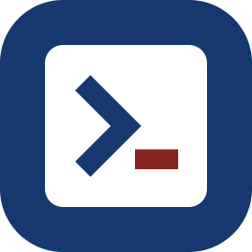

#  OpenAIDR by [OpenSecura](https://opensecura.ai/)

 

[Download app](#download-the-app) · [Get started](#get-started) · [FAQ](#faq) · [Documentation](docs/guide.md) · [Hook protocol](docs/hook-protocol.md) · [Contributing](CONTRIBUTING.md)

https://github.com/user-attachments/assets/53053234-d06a-4563-a5d5-fd492f595db1

*15-second product tour. All data shown is synthetic.*

**See every AI agent across your organization. Catch risky actions. Control usage and cost.**

OpenAIDR gives security teams organization-wide AI posture management,
centralized guardrail control, and detection for coding agents, with a personal
mode for a single device. Inventory, usage tracking, configuration checks, and
pattern rules run on your devices or on a server you run, and that code is in
this repository under Apache 2.0. Model-backed guardrail checks use OpenSecura's
hosted Intelligence service, which includes a free allowance for every install.

🚧 **Under active development.** Features, coverage, and setup may change.
[Join the community on Slack](https://join.slack.com/t/opensecuracommunity/shared_invite/zt-4fnlcya82-lvmBSjsSAyeTVp1OnZovMw)
to ask questions and share feedback.

## News

- **2026-11-05:** Initial release.

## What you can do

- **Understand every AI agent and tool.** Inventory AI apps, MCP servers,
  plugins, and skills on every device. Scan skill source code, match
  dependencies against known vulnerabilities, and check URLs and packages
  against threat intelligence.
- **Detect risky actions.** Work a detection queue with user risk, evidence
  search, detection rules, and investigation reports. Inspect the prompts and
  tool calls behind each decision.
- **Enforce guardrails centrally.** Define command, text, path, and host rules
  once and apply them at agent hooks on every device. Start in Shadow mode,
  then enable Enforce. Model-backed checks assess risky tool calls inline.
- **Track usage and cost.** Compare tokens and estimated costs by user, agent,
  and model.
- **Administer the workspace.** Enroll devices, manage users and roles, check
  health, and review audit logs.

Coverage is limited to supported tools and known configuration locations. See
[coverage](docs/guide.md#coverage) and
[guardrail behavior](docs/guide.md#guardrails-posture-and-overview).

## Get started

**Try it free.** Download the app and choose **Continue for free**. There is
no account, API key, or local server to set up, and every install includes a
free allowance of cloud guardrail checks. Teams can evaluate the full workspace
for free with a local runtime, or join an existing workspace with an enrollment
link. Build from source to develop OpenAIDR or run the open-source edition
yourself.

### Download the app

[macOS Apple Silicon (DMG)][mac] · [Windows x64 (EXE)][windows] · Linux x64: [DEB (Debian/Ubuntu)][deb] / [AppImage][appimage]

Checksums, release notes, and the build manifest are on the
[downloads page](https://releases.opensecura.ai/openaidr-oss/). The macOS app
is Developer ID signed and notarized by Apple. Windows and Linux packages are
unsigned, so Windows may show a SmartScreen warning on first launch.
The public build does not update itself; download new builds from the same
links.

How to open it on Windows

Run the downloaded installer. If SmartScreen displays
**Windows protected your PC**, select **More info > Run anyway**, if available.
See [Microsoft's SmartScreen guidance](https://learn.microsoft.com/en-us/windows/apps/package-and-deploy/publish-first-app#step-6-handle-smartscreen-for-new-apps).

**Personal.** After **Continue for free**, setup starts the sensor and
configures detected agents. Restart your agent sessions, then review usage and
guardrail activity in the app. Personal connections run checks in Shadow mode
by default. For paid access,
[contact OpenSecura](mailto:contact@opensecura.ai) for an OpenSecura API key
and follow the [API-key setup path](docs/guide.md#personal-paid-api-key).

**Join a workspace.** Choose **Connect organization** and paste the enrollment
link from your administrator. Administrators create links under
**Administration > App Enrollment**.

**Enterprise local evaluation.** Choose **Connect organization > Set up local
runtime**. Setup creates the database, server, and dashboard on your computer
and enrolls this device. It requires Docker with Compose; on macOS, setup can
install Docker Desktop for you. Its AI checks still use the cloud service. For
managed hosting or paid API access,
[request a demo](https://forms.gle/FxMfNgBoM9NHkUmQA).

See [step-by-step setup](docs/guide.md#personal-and-enterprise-setup) for
connection, credits, and enrollment details.

### Build from source

This repository contains the desktop app, sensor, dashboard, and local server.
See [Build from source](docs/build-from-source.md) for the macOS setup script
and the Docker Compose commands for Windows, Linux, and source builds.

## FAQ

**How does it work?** The desktop app runs a background sensor that observes
supported coding agents through installed hooks and native telemetry. In
personal mode, usage stays on the device. In a workspace, the sensor sends
permitted activity to the workspace server, which stores it in PostgreSQL
behind the dashboard. Guardrail rules are evaluated at agent hooks, and
model-backed checks call the Intelligence service.

**Which agents are supported?** Codex, Claude Code, GitHub Copilot, Cursor,
Antigravity, OpenCode 1.x, Hermes Agent, and WorkBuddy. Usage tracking and
guardrail coverage differ by agent, and agent versions and configuration affect
availability. See the [supported agents table](docs/guide.md#supported-agents).

**What is open source?** The desktop, sensor, dashboard, local server, SDK,
and the shared policy compiler and redaction helpers are Apache 2.0. Model-backed decisions run in OpenSecura's hosted Intelligence
service. See the [open source boundary](docs/open-source-plan.md).

**What leaves my device?** Cloud checks send the redacted evidence they need.
Organization connections send permitted activity to the workspace server. The
Intelligence service retains request metadata, not request contents. Review the
[capture controls and data handling](docs/data-handling.md) before collecting
prompts or tool content.

**Will it block my agents?** Personal connections use Shadow mode by default:
decisions are recorded and actions continue. A local rules file can switch a
personal connection to Enforce; see
[local rules](docs/guide.md#personal-local-rules-and-enforce). Workspace
administrators can enable Enforce at supported hooks. When a check fails or a
service is unavailable, OpenAIDR allows the action; native agent permissions
and hook behavior still apply.

**How does free usage work?** Cloud checks consume OpenSecura service credits.
The connected service sets the free allowance and reset period. Paid access
uses an OpenSecura API key. These credits are separate from your coding-agent
subscriptions and token costs.

## Contributing

Bug reports, documentation, tests, and code are welcome. Read
[CONTRIBUTING.md](CONTRIBUTING.md) for the process and the
[development guide](docs/guide.md#contribute-and-test) for the checks to run.
Include your build version, operating system, and reproduction steps in bug
reports, and remove credentials, prompts, and private files.

---

**Want OpenSecura to do the heavy lifting?** [Request a demo](https://forms.gle/FxMfNgBoM9NHkUmQA).

[mac]: https://releases.opensecura.ai/openaidr-oss/latest/OpenAIDR-macos-arm64.dmg
[windows]: https://releases.opensecura.ai/openaidr-oss/latest/OpenAIDR-windows-x64-setup.exe
[deb]: https://releases.opensecura.ai/openaidr-oss/latest/OpenAIDR-linux-x64.deb
[appimage]: https://releases.opensecura.ai/openaidr-oss/latest/OpenAIDR-linux-x64.AppImage
