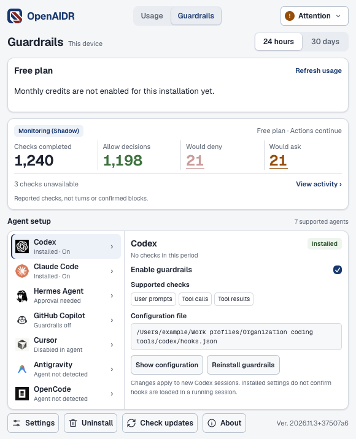
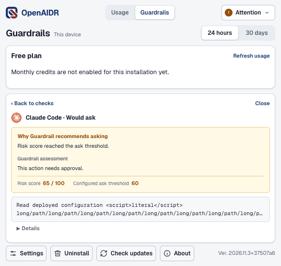
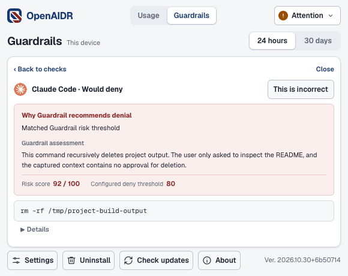

# OpenAIDR desktop app

**OpenAIDR** is the desktop product name for AI activity monitoring and
guardrails. See the [naming decision](NAMING.md) for app, installer, and release
names and compatibility with existing installations.

This Tauri 2 application shows personal device usage and manages the Python sensor
and guardrails bundled in `openaidr`. The Mac release is one universal app for
Apple Silicon and Intel Macs with macOS 12 or later. Intel installations do not
yet receive in-app updates because the update feed lists only Apple Silicon.
After enrollment,
automatic setup installs and starts the
background service and connects detected Codex and Claude Code installations,
respecting separate telemetry and hook opt-outs. The window shows sensor health
and desktop update progress and provides connection and uninstall controls on
macOS and Windows.
Individual service and agent controls remain in the CLI. The tenant dashboard
runs separately. Linux servers can use the Python CLI and systemd without Node,
Rust, or a desktop environment.

The credit card reads the server's explicit allowance policy. Starter credits
are a one-time grant and have no reset date. Google accounts show the weekly
allowance, account email, and next reset. Legacy APIs retain their existing
credit display until the new policy is activated. Deploy compatible desktop
and SDK readers before activating lifetime allowances, because older readers
require a reset date. Account allowance reads require the new API endpoint;
an unavailable response shows an error rather than an invented balance.

From the sensor status card, select **Sign in with Google to get 200 credits
each week**. The system browser opens `https://console.opensecura.ai/`; sign in
and confirm this device. The app polls its original free installation's request,
verifies the new account credential, stops the sensor, and atomically changes its
connection before restarting. Local usage, queues, and device identity remain.
**Open console** returns to the account in the system browser.

The native sensor stores a generated device key in its private data directory
before sending its hash to the API. The browser receives only the pairing
request ID. Retry reuses that exact key and request, including after a lost
reply or hostname change. Approved receipts remain recoverable after the browser
approval window ends. Cancelling in the app pauses polling; it does not delete
the saved key or undo a browser approval. Start sign-in again to resume.
An expired request is replaced only after the API confirms expiration.

Deploy the API allowance and desktop-connection endpoints, then the console
confirmation page, before releasing this desktop flow and enabling the backend
policy. Rollback keeps account keys and local data. Do not restore anonymous
credentials or delete the pairing file to work around a failed sign-in; retry
the same request so the server can reconcile its existing approval.

**Posture** shows this device's inventory with Overview, AI Apps, Supply Chain,
and AI Skills pages. Review findings and
collection details, search loaded records, or filter items needing attention.
Organization approval is separate from security assessment. Missing or partial
collection and truncated lists remain visible; the view does not scan the device,
change approvals, or modify agent configuration. Free and API-key connections
show locally collected inventory, including known AI apps from the local catalog,
even when the cloud is unavailable. These records have assessment labels instead
of organization approvals. Collection alone does not assess security, and reading
or refreshing the view sends no inventory or assessment request to the cloud.
On Overview, personal connections can explicitly enable or pause automatic
checks. These checks send package identifiers and, when supported, skill content
to OpenSecura and use account credits. Each skill review sends all captured text
in one billed request; unchanged completed reviews are reused. Skill AI review
is partial. The card keeps
the account's available credits separate from confirmed Posture charges recorded
on this device. Missing balances and receipts show as unavailable. Consent is
bound to the current connection; changing accounts requires new consent. Pausing
stops new checks, while admitted work can finish.
Organization connections require a server supporting `POST /ingest/v1/posture/summary`;
older servers show an update message. Rolling back the desktop removes this view
without changing retained inventory.

Under **Connect your organization**, choose an enrollment link or **Set up local
runtime** to start setup automatically. On macOS, setup downloads Docker Desktop
if needed, verifies its checksum and signed application, and runs Docker's
installer. Approve the macOS permission prompt and accept Docker's terms in its
own setup window. If Docker is already installed, setup opens it. Setup waits
for Docker and then continues automatically without another start click. If setup is
cancelled or Docker remains unresponsive, finish its prompts and retry. Windows
and Linux require a running local Docker engine with Compose. All platforms need
internet access to download dependencies and register the free allowance. The
desktop includes the runtime source, so Git, Python, and a GitHub login are not
required. Setup builds and starts PostgreSQL, the server, and the dashboard,
connects this device, then runs the normal sensor and guardrail setup. The first
build can take several minutes. Retry preserves credentials and database data.
See the [connection choices](docs/local-runtime.png) and
[automatic setup progress](docs/local-runtime-automatic.png), captured from the
running desktop UI with a simulated native bridge.

The dashboard listens at `http://localhost:8080`, bound to `127.0.0.1`. AI checks
use OpenSecura cloud services. **Open dashboard** signs in automatically for a
desktop-managed runtime, including runtimes created by earlier desktop versions.
The desktop uses the saved credentials and a single-use loopback handoff that
expires after 60 seconds. The password and session cookie never appear in the
browser URL. This requires only a desktop update; the runtime and its data stay
in place. Reverting the desktop restores manual sign-in.
**Show dashboard sign-in** reveals the generated
`admin@localhost` password only on request. An existing local runtime uses its
own `admin@localhost` password; setup does not replace that stack. Another app
using port 8080 must be stopped before a new runtime can start. Remote Docker
engines are rejected. Setup can select the local Docker Desktop socket without
changing your active Docker context. Each newly prepared runtime keeps its
selected engine on retry; start that engine if it is unavailable. Existing
runtimes without a saved engine keep using their local context. Keep Docker
running while using the local runtime.

Runtime source, `.env`, and private `state.json` are stored in `local-runtime/`
beside the sensor configuration. Compose containers, images, and volumes use a
project name derived from that directory. Back up the directory and its Docker
database volume together. Closing the desktop keeps the runtime running. On
macOS, uninstall stops runtimes created by this desktop installation and keeps
their data by default. **Delete local data** also removes their containers,
volumes (including the database), networks, generated image tags, and saved
configuration. Shared Docker images, build caches, and Docker itself are kept.
Separately installed runtimes are never stopped or deleted. Docker must be
running for cleanup; failures keep the app installed with retry controls and
preserve the runtime configuration until Docker deletion succeeds. **Reinstall**
restarts a retained runtime from its saved source and configuration, including
after a desktop upgrade, when the sensor is connected to it. Switching
back to an enrollment link, or rolling back the desktop, keeps the local stack;
back up any required data before selecting **Delete local data**. This release does
not automatically update the local stack or expose it to other devices.

The bundled Apache-2.0 source is a filtered archive of
`opensecurainc/openaidr` commit `4d52ae0063d7af8ec18267041f6fd66866d03d5b`,
version `2026.11.1+4d52ae0`. It includes the public SDK and common wheels, the
license, and the server/dashboard build inputs. It excludes the private service,
cloud operations, and brand submodule. Its SHA-256 is
`790495e7424a200e53e1f81c1da8b08d3b446d0617762abed242cc84cc76c0b8`.
To reproduce it, download that commit's GitHub tarball, then run
`python3 scripts/bundle_local_runtime.py SOURCE.tar.gz OUTPUT.tar.gz` from the
repository root. Updating the pin requires reviewing the source boundary and
testing a clean Compose build, enrollment, and retry before updating the source
constants and archive together.

On macOS, drag OpenAIDR from the disk image to `/Applications` or
`~/Applications`, then open the installed copy. Packaged builds show installation
instructions and quit when opened elsewhere, before starting the main window or
background work. Debug development runs are exempt. This check does not require
the installed app to be owned by the current user or its folder to be writable.
See the [mounted installer](docs/dmg-installation.png) for the installation layout.

Store local copies of release installers in [`releases/`](releases/), grouped
into `macos/`, `linux/`, and `windows/`. See
local installer folders for storage and
download locations.

Use the macOS signing runbook to publish a signed release, locate
signing credentials and recovery copies, or verify an installed app.

### Enterprise distribution

Build with `python scripts/build_desktop.py --edition enterprise` to require an
organization enrollment link. This build omits free and personal API-key setup,
the local runtime setup interface, and the bundled local runtime source archive.
The bundled sensor also rejects those setup actions. Existing personal or
desktop-managed local connections require organization enrollment before setup;
their data is kept. Reinstall does not restart a retained local runtime.
Explicit uninstall and data deletion retain their existing cleanup behavior.

Use `--edition standard` for the existing full app. The build also accepts
`OPENAIDR_DESKTOP_EDITION=enterprise`; an explicit `--edition` takes precedence.
The edition is recorded in the app and sensor build metadata and cannot be
changed by an environment variable after installation. The version format and
bundle identity stay the same. Organization billing and service access remain
server responsibilities; the edition is not a payment or license check.

Use the same edition when compiling and bundling a Windows installer. Select
the enterprise edition for every platform build published to the enterprise
release channel, including later automatic updates. Do not publish different
editions under the same version and target. The enterprise release channel
rejects standard and edition-less builds, including retained publication retries.
Roll back by restoring the previous enterprise implementation at a new source
version and applying the normal release verification. Standard builds require
separate distribution.

The window is 580 logical pixels wide and fits its height to the content,
bounded to 160–720 logical pixels and the monitor's available work area.
Manual resizing is disabled. The page scrolls when content exceeds the available
height; long removal details and dialogs can also scroll within their panels.
The **About** button opens the app identity, offline license notices, and a
**Contact support** link to `contact@opensecura.ai`. On macOS, the application
menu also has **About OpenAIDR**. The dialog works without enrollment or a
running sensor. It opens the configured email app without attaching device data.
See the [light](docs/about-light.png) and [dark](docs/about-dark.png) browser
renders. Native Windows and Linux window rendering is not shown in these images.
The main view shows daily estimated API-equivalent cost, token totals, and app,
model, and reasoning-effort breakdowns for 14 or 30 local calendar days, including today.
Daily totals and Today follow the device's timezone, including daylight-saving
changes. Timestamps remain stored as absolute instants.
The top-right status button opens sensor details, including last server contact,
collection guidance, errors, record counters, and recovery actions. All details
appear immediately. Identical errors appear once with their affected sources;
distinct errors remain separate. Close the popover with the button, the close
control, Escape, or a click outside. Green shows a running sensor, orange shows
pending work or a warning, and red shows a failure. **Offline** means the sensor
is unavailable; server connection failures use **Connection lost** while the
sensor is running.
Temporary connection failures have a 15-minute grace period after the last
successful server heartbeat. During that period, the running sensor stays green
with **Connected (x mins ago)** and a retry message. At 15 minutes it shows
**Connection lost**. During the desktop session, the grace period is also bounded
by the last contact recorded when the connection failure was first observed;
later successful heartbeats cannot extend it while upload errors persist. It
resets when the connection errors clear or the device connection changes. Queued
uploads keep retrying, with their errors and queue counts visible in the popover.
First-contact failures, invalid or future contact timestamps, authorization or certificate
errors, unknown failures, and setup or guardrail warnings do not receive this
grace period. This changes only desktop status presentation; uploads, retry
timing, and guardrail decisions are unchanged. No server update or migration is
needed; rolling back the desktop restores immediate connection warnings.
Enrollment and removal guidance remain in their own screens. The popover can
scroll when the monitor's work area cannot fit all of its contents.
Status normally refreshes every 15 seconds while the window is visible, with
one-second checks during sensor startup and while waiting for its first server
contact. First-contact errors return to the normal interval. These checks read
local status; they do not send extra server heartbeats. Returning to the window
refreshes status immediately and usage once the sensor is ready. Failed status
reads offer **Retry status**; setup failures retain **Retry setup**.
When an update or sensor operation holds the local operation lock, the app shows
a compact yellow **OpenAIDR is updating.** notice with **Check again** below it.
Status checks run every three seconds while visible. Genuine status failures keep
their error state.
Usage comes from the device's local ledger, refreshes every 10 seconds while the
window is visible, and remains available offline. Totals include only retained usage and do not
represent a subscription invoice. Both periods are cached in memory and refreshed
in the background. Switching periods keeps cached charts visible, including
during sensor setup. While setup runs, only loaded periods can be selected and
new usage reads wait until setup finishes. Changing the device connection clears
the cache. **Estimated Cost (API Equivalent)** excludes
unpriced calls; hovering the amount identifies this when applicable.
On the first sensor startup, a background import reads retained Codex, Claude
Code, and Gemini CLI usage from JSON and JSONL files for the last 30 local
calendar days. It includes Codex archives, Claude subagent logs, and Gemini
chat files under `~/.gemini/tmp/` (or `GEMINI_CLI_HOME/.gemini/tmp/`). No agent
databases are read. Existing installations import Codex and Claude usage only
from before local collection began; Gemini imports once when support is first
installed. This adds historical Gemini usage, not ongoing Gemini collection. The chart
fills on its normal refresh; missing logs keep the existing zero totals.
Only usage metadata enters the local ledger, with no transcript content or
historical uploads. Restarting resumes an interrupted import without adding
the same usage twice. Changing enrollment does not import the old history into
the new device identity. See desktop usage
for retention, pricing, and compatibility limits.
The importer checks recorded profile paths every 30 seconds. New paths and a
new bundled import revision revisit legacy history within its original cutoff.
It also recovers newer Codex requests with `token_usage_record.response_id`
and Claude assistant entries with `requestId`, including usage missed after
installation or during a collection outage. These identifiers match native
reports exactly. Changed files resume from a committed offset; unchanged files
are not reread. A replaced or truncated file is replayed without counting the
same request twice. It reads the selected agent home and paths registered by
telemetry setup, including custom profiles.
Setup records shell profile overrides before starting the service. GUI setup
cannot discover an unrecorded shell override: configure it from that shell with
`openaidr telemetry configure --agent codex` or `--agent claude` first.
An upgrade can fill missing per-call prices from retained source files while
preserving known costs. Fable 5.1 uses the [published input, output, and cache
prices](https://platform.claude.com/docs/en/models/fable-5-1/overview).
A delayed native report replaces an estimate for the same request, including
after the call was summarized into older totals. Existing native reports remain
authoritative.
Unmatched legacy native records and reports without a supported request ID
prevent overlapping recovery. If an ambiguous report arrives after recovery,
provisional recovered calls for that agent are withdrawn to avoid duplicate
totals; the source files remain available for a later safe retry.
Deleted history, unsupported records, and old summarized calls whose original
contribution is unavailable cannot be reconstructed completely. The importer
does not infer matches from similar timestamps or token counts, and it does
not restart coding-agent sessions. Live authentication failures still require
the affected client to reload its settings.
This requires the updated sensor and adds local provenance, recovery receipts,
and file checkpoints. No history is uploaded. Older sensors retain readable
usage on rollback but do not perform recovery or reconcile delayed reports;
the next upgrade checks ambiguity before resuming recovery.
**Historical cost may be incomplete** appears when hovering or focusing the
info icon beside **Estimated cost**. Usage charts include retained historical
usage without marking when local collection started.
When the sensor supports ongoing request recovery, Usage also shows additional
recovered calls over the retained 30 days, the last check, and unreadable,
unsupported, or ambiguous history. These results describe the full retained
window for either selected chart period and do not certify complete capture.
See the [history preview](docs/usage-history.png), captured from the running UI
with sample data. The note and Gemini labels require the updated desktop;
the Gemini import requires the updated sensor. Roll back either component
without changing the local ledger or deploying a server migration.
The desktop keeps a read-only `desktop-usage` helper running across refreshes.
It caches hourly aggregates and uses local SQLite revision triggers to reload
changed hours. The current hour and the rolling 24-hour cutoff are read again
as time advances. Each read releases its database snapshot; collection and
pruning continue between reads. Status polling remains on its own schedule.
The helper reloads device configuration for each request, resets its cache when
the device identity or database changes, and exits when the app closes its
input. The app stops it for setup, connection changes, removal, and exit, and
starts a replacement after failure or a binary change.
Update the desktop and bundled sensor together for the cached path. Older local
ledgers remain readable through uncached queries until sensor startup creates
the additive revision table, triggers, and scope/time index. Older sensors can
still write the ledger and invalidate the cache through those triggers. Rolling
back the desktop restores its previous refresh behavior; no server migration or
removal of the local cache metadata is required.
The token summary shows input tokens (including cached input), the input cache
rate, and output tokens, for example **2 B in (98% cached) / 10 M out**.
Token totals use up to three significant digits, for example **999 M**,
**99.9 M**, **9.99 M**, or **999 k**, with exact counts available on hover.
Cache rate is cached input divided by cached plus uncached input; it shows N/A
when there are no input tokens. Older or incomplete token breakdowns keep the
aggregate total and explain the missing detail on hover.
Estimated Cost (API Equivalent) appears beside the token summary. **24 hours**
shows a rolling window with hourly bars, the hourly average, peak hour, and cost
this hour. The cutoff is exactly 24 hours before the snapshot, including across
daylight-saving changes. The first and current clock hours can be partial, so
the chart has 25 hourly positions. The average divides the total by 24.
**30 days** remains the default and shows daily bars, the daily average, peak
day, and today's cost so far under **Today**. Its average divides the total by
30 local calendar days, including today. Both views use estimated cost in USD and
consistent app colors.
Hover or focus a bar for app totals and each model's estimated cost, combined
across reasoning levels.
Long tooltips scroll within the available window; Escape dismisses them.
The Models and Reasoning effort cards show period totals across apps.
See the [30-day view with today's cost](docs/usage-today.png) and the
[24-hour view](docs/usage-24-hours.png), both with sample data.
Older sensors without grouped data retain total-only daily bars.
Days without calls show $0.00; calls without a known cost
show N/A. Partially priced periods and days show the known cost and identify
excluded unpriced calls. Daily bars use the stored total cost, without inferring
cost shares from token counts. **Connection** expands the
enrollment-link form below usage and keeps the status button visible.
Long sensor errors scroll inside the popover. Compact update notices are
truncated with their full text in a tooltip. Update recovery guidance also
appears below the header.
Local telemetry submission requires no credential. Existing agents can keep
reporting with stale authorization headers after a sensor update or local-data
reset, provided they still target the same receiver address. Once the updated
sensor is running, it no longer reports telemetry authentication failures and
the associated restart warning clears. Saved usage remains readable.
Configured agents describe installed settings, not confirmation that every
running session has loaded a new destination or capture setting.

The desktop retains rejection details and restart guidance for older sensors
that still require telemetry credentials. Update the sensor to remove that
requirement. The separate local hook/status listener retains authentication.
See collection and delivery behavior
for the local trust model, rollout, and rollback steps.

Setup failures, disabled telemetry, and manual sensor restart guidance appear
in the status popover. Device identifiers,
receiver addresses, and individual agent details are available through the CLI.

Company comparisons show the share of calls using High or higher effort for
the same model and time window. They exclude this device and require at least
20 calls with known effort on this device and 20 across at least five other
devices. Effort coverage is displayed for both groups; Unknown and Auto do not
enter this comparison. Task complexity and task outcomes are not compared, so
the app does not recommend switching models or effort. Other users' names,
projects, prompts, and individual device statistics are not returned.

Only effort reported on a usage record is assigned to its cost. Codex transcript
turn effort and hook effort are retained as event metadata, but are not used to
guess effort on unmatched usage records. Unknown can therefore remain common
on agent versions that omit effort from per-request telemetry. Transcript
capture stays subject to its existing opt-in settings.

Update the desktop and its bundled sensor together for local usage breakdowns.
No backend deployment or server migration is required. The sensor adds a
separate token-details table to the local telemetry database and recovers
details from queued exports before upload removes them. Already uploaded
exports cannot supply missing details. The ledger keeps 30 local calendar days
of totals. Above the 100,000-call detail target, the sensor atomically summarizes
older calls before deleting their details. It always retains the last 24 hours
of details so the rolling cutoff remains exact, even above that target. Pending
history imports also retain their details until final assistant blocks have
been reconciled and the application scan completes.

Summaries retain application, model, reasoning effort, cost, priced/unpriced call
counts, and cached/uncached input and output tokens. Internal 15-minute slices
support hourly and daily views and local midnight after timezone changes,
including fractional-hour offsets. Compact event IDs prevent retries and
re-enrollment from counting summarized calls again. Summaries and these IDs
expire with the 30-day window; they retain no prompts, commands, or transcript
content. Summary values reflect the evidence available at compaction; later
replays do not reprice or revise compacted calls.

The usage storage allowance is 256 MiB, in addition to the existing telemetry
queue budget and request allowance. This is a shared database allocation limit,
not a guarantee of unlimited burst capacity. Update the desktop and sensor
together. Tables are added locally without a backend migration. Existing gaps
from earlier pruning remain marked incomplete and are not backfilled.

Rollback requires no destructive schema change. Older sensors can still read
and write the original detail ledger but do not display summaries. Saved
summaries become visible again after upgrading; old versions can still lose
new history through their original pruning behavior. Do not delete the new
tables during rollback. New records written by versions without token
breakdowns can recover those details only while their exports remain queued.

The sensor also retains application identity from native Codex and Claude Code
usage events in a separate local table. `usage.summary` includes a `breakdown`
for the selected period and each hour or day, grouped by `application`, `model`, and
`reasoning_effort`, with the same counts and costs as the existing totals.
Existing consumers can ignore these added fields. Upgrade reprocesses retained
queued exports before upload, without counting calls again. Previously delivered
records without app identity remain `unknown`, displayed as **Unattributed** with
an explanation that older sensors did not retain app identity. Model names do
not determine apps.
The app details expire with the original usage records. Older sensors can still
read and write the unchanged original ledger after rollback. No server migration
or backend deployment is required.
Update the desktop with the sensor: usage responses can now be up to 8 MiB,
while other responses retain the 1 MiB limit. Older desktops may reject larger
grouped histories; rolling back both components restores the smaller response.

Local sessions in Claude Desktop's Code tab report the telemetry service name
`claude-code-desktop`, while CLI sessions report `claude-code`. The usage parser
accepts both and groups them as **Claude Code**, including events with or without
the `claude_code.` prefix. Sensor upgrades recover previously missed Desktop
usage from exports still queued on the device. Already delivered exports cannot
restore missing local details. Deploy the updated backend to apply the same
parser fix to server accounting; no database migration is required. Hooks are
configured separately from usage telemetry. This support is for the Code tab;
it does not configure Cowork or Chat collection. See Anthropic's
[service information](https://code.claude.com/docs/en/monitoring-usage#service-information)
and [Desktop configuration](https://code.claude.com/docs/en/desktop#configuration).

Received Cowork OTLP logs (`service.name=cowork`) are counted separately as
**Claude Cowork**, including input, output, cache-read, and cache-creation tokens
and reported estimated cost. Requests and project attribution stay separate
from Claude Code even when their identifiers match. Sensor upgrades recover
Cowork usage from exports still queued locally; already delivered local exports
and previously processed server exports are not replayed by this change.
Update the desktop and sensor together, and deploy the backend for server
accounting. No database migration is required. Rolling back stops counting new
Cowork events; retained usage remains readable, though older desktops show an
unknown app label for it.

The sensor automatically collects new local Cowork audit records when Claude
Desktop writes them, using existing capture controls and restart-safe
checkpoints. Cloud-only sessions may have no local audit file. Personal Pro/Max
accounts can use the generated Cowork hook plugin; Enterprise can use signed
inference hooks and the authenticated organization OTLP receiver. Both hook
paths use the existing Shadow/Enforce setting and fail-open behavior. Setup,
capture limits, account attribution, qualification, and rollback are documented
in the Cowork integration guide. A plugin import alone
does not establish that Cowork invokes its hooks. Do not use device receiver
credentials in organization settings.

The [app and model cost preview](docs/app-model-cost-mock.html) is a standalone
design mock that uses sample data to explore application colors and model shades.

The [setup choice preview](docs/setup-choice-mock.html) places **Continue for
free** and **Connect organization** side by side at the native window width.
See the [rendered PNG](docs/setup-choice-mock.png). All preview controls are
inert; the installed app still uses its existing enrollment screen. Production
free setup needs a separate runtime integration before this design can be used
in the app. Run `pnpm test:web tests/setup-choice-mock.spec.ts` from
`apps/desktop` to verify the layout in Chromium and WebKit, including a smaller
work area that requires scrolling. The preview uses the existing app styles,
fonts, and logo and does not enroll a device or start a service.

The sensor continues running when this window closes. On macOS, the bundled executable is copied to `~/Library/Application Support/OpenAIDR/bin/openaidr`; the Python service installer configures a user LaunchAgent pointing there. An older app never replaces a newer staged executable: the window compares the two `version` outputs and keeps the newer one, and a stopped service that last ran a newer version is not started from an older executable either. Keep the app installed to receive future executable updates, but the service does not execute from inside the app bundle. User LaunchAgents start at login.

On macOS, **Show in menu bar** is in **Settings**, above the connection controls.
It is available before enrollment and when the sensor is unavailable, off by
default, and saved per user. Enabling it adds the color OpenSecura logo with a
native menu showing sensor health, **Open OpenAIDR**, and **Quit OpenAIDR**.
The tooltip and menu show warnings and unavailable status.
Closing the window keeps the menu available and removes the app from the Dock;
opening it again restores the same window. Quit removes the icon and exits the
desktop app without stopping the sensor. This option does not start the desktop
app at login; the sensor's existing login behavior is unchanged.
See the running UI with test data in the [main window](docs/settings-main.png),
[Settings dialog](docs/menu-bar-light.png), and a
[small work area](docs/menu-bar-small-work-area.png).

On Windows, **Show in system tray** in **Settings** offers the same optional status
menu and close-to-tray behavior. The color app icon shows health in its tooltip
and menu.
Opening OpenAIDR from the menu, a notification, or a second app launch restores
the existing window and resumes foreground refreshes. It is off by default,
persists per user, and does not add desktop startup at login. Windows updates
retain their existing app restart behavior. See the running UI with test data in
the [normal window](docs/windows-tray-light.png) and a
[small work area](docs/windows-tray-small-work-area.png).

On Linux desktops, **Show in system tray** in **Settings** uses an
AppIndicator-compatible host (such as KDE's tray or GNOME with AppIndicator
support). Health appears in the menu. If no host is available, the preference
explains that closing the window exits the app normally. If the host disappears while OpenAIDR is hidden, the
window reappears. This also handles a lost session bus. The preference remains
saved so the tray can be used when a host returns. The sensor keeps running in
all cases. Headless servers and background updaters do not create a tray icon.
See the [no-host fallback](docs/linux-tray-fallback.png) and
[small work area](docs/linux-tray-small-work-area.png) with browser test data.

The menu uses the window's health rules, including the connection grace period.
Native events request local status every 15 seconds while the window is hidden,
without refreshing usage charts or running automatic setup. If the window stops
reporting health for 45 seconds, the next native check shows **Status unavailable**.
On macOS, an installed desktop update waits until the window opens before
restarting the interactive app. Background updater processes do not create a tray icon.
Disabling the option restores normal window-close behavior. The saved preference
remains compatible with earlier tray-enabled versions. Rolling back restores
the previous settings location and menu bar icon without a sensor or server migration.

On macOS, only one interactive desktop app runs per user and application identifier.
Opening another installed or development copy restores and focuses the existing
window, then exits after activation is confirmed and before accessing the sensor.
If the previous app quits before replying, the new launch takes over. Before an
automatic desktop restart, the app stops acknowledging new launches so its
replacement can take ownership after it exits.
A native file lock is acquired before the window starts; the operating system
releases it on normal exit or a crash. Activation uses a socket in a private
directory under the OS-provided user cache directory (`DARWIN_USER_CACHE_DIR`).
Apple's [confstr(3) contract](https://github.com/apple-oss-distributions/Libc/blob/main/gen/confstr.3)
excludes this location from routine cleanup and
permits clearing it during safe boot, when the previous owner has already exited.
The parent must belong to the user and prevent other accounts from writing to it.
The app identifier determines the socket directory. It
carries only a request to show the window and an acknowledgment. Background
update workers retain their own updater and sensor-operation locks and do not
activate the window. On macOS, opening a window in an update worker first claims
the same desktop lock or activates the existing desktop.
The macOS bundle starts as an agent app with no Dock icon. Before the event loop
starts, background checks and update handoffs retain that mode; normal window
launches select the regular Dock-visible mode. Explicitly opening a window in
a background worker also restores the regular mode.
Windows uses Tauri's single-instance plugin to focus the existing window on a
second launch. Managed Linux AppImages use a window lock to prevent duplicate
windows and to coordinate update replacement; a second launch exits without
focusing the existing window. Unmanaged Linux installations do not use this
updater window guard.

Quit all desktop copies once when upgrading from a version without this guard.
To run a newer build, quit the current desktop app before opening the new one;
the background sensor continues running. No service or data migration is needed.
Rolling back the desktop removes this guard, so keep only one copy open.

## Enroll with a link

In **Administration > App Enrollment**, the header has four buttons:
**Create enrollment link**, **Mac install script**, **Win install script**, and
**Lin install script**. Choose the recipient's platform, set the label and expiry,
then create and copy the script. Each platform button opens its own form without
an operating-system selector. The enrollment-link button creates a link for manual
setup. Paste an install script into the recipient's Terminal or PowerShell and
confirm the organization to connect without pasting the link into the app.

| Platform | Installation and verification |
| --- | --- |
| Mac | macOS 12 or later, Apple Silicon or Intel. Uses the published universal DMG, checks the OpenSecura signature and Gatekeeper, then installs in `/Applications`. The account must have write access to that folder. |
| Windows | Windows x64, 64-bit PowerShell 5.1 or 7, without **Run as administrator**. Downloads the installer ZIP, checks its contents and the OpenSecura Authenticode signature and timestamp, then runs the per-user installer. |
| Linux | Ubuntu/Debian x64 with Python 3, curl, GnuPG, and sudo. Downloads the DEB and verifies its checksum, package identity, and detached signature against the pinned OpenSecura signing key. Uses sudo to protect the package copy and install it with `apt-get`, including native dependencies. Verifies the protected copy before installation. Enrollment and `openaidr setup` run as the signed-in user. |

Downloads come from `https://releases.opensecura.ai/openaidr/`. Linux resolves the
immutable DEB and signature URLs from `rollout-v2.json`, falling back to the older
`rollout-v1.json` only when v2 returns 404. This installs a DEB; it does not enable
AppImage updates. Other Linux distributions and ARM64 Windows/Linux are not
supported by these commands.

The command contains the same secret as the link and shares its use limit. It
may remain in shell history. Share it only with intended recipients. Closing the dialog
clears both values from the page; neither is stored in browser storage. The
bootstrap scripts ship as public dashboard assets and contain no credentials.
Deploy the dashboard UI and assets together; rollback is the previous dashboard
image. No enrollment API or desktop protocol change is required.

Run interactive scripts as the account that uses your coding agents. Supported
existing installations are reused without replacement, and existing enrollments are kept. Custom Windows
installations and detected Linux AppImage installations require using the existing
app. These commands do not upgrade or migrate existing installations.

For an unattended Mac deployment, choose **Mac install script > Install mode >
Silent MDM**. Run the generated Bash script through MDM as root or as the
logged-in user. A new installation requires write access to `/Applications`;
an existing verified app can be reused without write access to that folder.
The script never elevates a normal user's privileges or uses sudo in that mode.
When run as root, it drops privileges into the console user's login session for
enrollment and background sensor setup. It does not display confirmation or result dialogs, ask for a
password, or open the desktop app. Successful installation returns exit code 0
only after the sensor service is running; failures return a nonzero exit code
and a message in the MDM output. The enrollment secret stays on standard input.

This mode requires macOS 12 or later on Apple Silicon or Intel and an active console
user. At the login screen or during Setup Assistant, it exits before installing
or enrolling; configure MDM to retry after login while the link is valid.
Retries preserve an existing enrollment without consuming another token and
retry background setup. Existing app copies are reused without upgrading them.
An account with a retained uninstall record must have its installation restored
before using the MDM script. It does not enroll root, all accounts, or future
users. A normal account must be the active console user; another account is
rejected before installation or enrollment. Fresh installations made as root
are root-owned. Silent setup does not register the desktop updater, so use MDM
to manage app updates. Existing update registrations are kept.

Silent mode suppresses OpenAIDR dialogs, not macOS security controls. Deploy any
required [privacy permissions](https://support.apple.com/guide/deployment/dep38df53c2a/web)
and [managed background items](https://support.apple.com/guide/deployment/depdca572563/web)
profiles through MDM before installation. It preserves signature and Gatekeeper
checks and does not alter privacy databases or remove quarantine attributes.
macOS can still show a managed background-item notification with these profiles.
The interactive script remains the default. Ship the dashboard UI and updated
`install-macos.js` together; no new sensor or enrollment API is needed. Roll
back both dashboard changes together; existing enrolled devices stay connected.
Generated MDM commands check the downloaded script's MDM support before use.
After a rollback to an older dashboard, they fail with a nonzero exit code
instead of treating an unsupported option's usage message as a successful install.

The Mac script keeps existing copies in `/Applications` or `~/Applications` at
their current location. If OpenAIDR was uninstalled but its settings were kept,
the interactive script asks to reinstall for the saved organization, restores
the saved agent preferences and automatic updates, then reopens the app for
automatic setup. No additional **Install** click is needed in the app. The existing
enrollment is kept and the supplied link remains unused. Cancelling keeps the
uninstall state; failed restoration keeps its record for a retry. A running app
must close before restoration, and an active update or uninstall blocks it.

The copied Mac and Linux commands supply the link through standard input. Windows
keeps it in the current PowerShell process. All three pass it to the bundled sensor
over standard input, never a child process argument or temporary file. Interactive
scripts ask to confirm the organization and server before connecting. Cancellation
before confirmation leaves the link unused and keeps any completed app installation. The commands do not
retry enrollment requests. After a connection failure, check the app
before trying again. For a private server CA, use the app's certificate controls.

Interactive Mac and Windows scripts open the app to finish automatic setup. Linux
runs `openaidr setup` and reports if it needs attention. Check the app's status and restart coding-agent
sessions after setup. Interactive installation prompts still require the
recipient's response.

For a guided Mac installation from a repository checkout, run:

```sh
osascript -l JavaScript apps/dashboard/public/install-macos.js
```

This direct form asks for the enrollment link in a private dialog.

An owner or administrator creates an enrollment link from **Administration →
App Enrollment → Create enrollment link** in the dashboard. Links expire
after 1 hour by default, with 24-hour and 7-day options. **Max uses** defaults to
100 device enrollments and accepts a positive whole number; set it to 1 for a
single-use link. Share the full link with the people installing the sensor.

Paste the link into the desktop app. Instructions and link errors appear directly
below the link field, above the optional certificate controls. The app previews
the organization and server without consuming the code. Choose **Connect** to
enroll, receive the server’s configuration and policy, and start automatic
background setup. On servers using device certificates, the verified preview
supplies the required tenant identity and selects mTLS automatically. Links
require HTTPS; loopback HTTP is supported for local development. TLS verification
remains enabled.

The link’s code is in its URL fragment. Opening its browser landing page leaves
it unused. The app sends the code in request bodies, never as a query parameter,
and clears it on submission or cancellation. It never stores the link in
browser storage. Only the enrollment transaction consumes the
code; an expired, revoked, or previously used code cannot enroll another device.

For a private-CA server, paste the enrollment link and open **Private server
certificate (optional)**. Choose the public CA certificate supplied by your
administrator as an ASCII PEM file of at most 32 KiB. The app uses the same
certificate to verify the organization preview and the connection, with normal
certificate-chain and server-name checks. Private keys are rejected. Trust is
saved for the sensor only after enrollment succeeds; preview does not change
saved trust or macOS trust settings. This also supports initial device-certificate
enrollment when the preview selects mTLS.

Changing the link to a different server clears the selected certificate.
**Remove file** discards the selection and checks the link again with the
existing trust. Canceling or submitting clears the file and link from the form.
Existing organization CA trust is reused only for the same server. Public-CA
servers need no file. The sensor CLI
remains available for administrator-assisted certificate migration and recovery.

**Settings** can switch an enrolled device to another organization or server,
including when either connection uses device certificates. The app waits for
queued uploads, stops the sensor, and verifies the disk queues are empty before
enrolling. A certificate-related switch stages the new identity and activates
its certificate before replacing the active connection. Any pending certificate
operation on the old connection must finish first. Failure before that
replacement keeps the old identity, trust, queues and collection checkpoints,
and restarts a previously running sensor. New enrollment requests never send the
old organization's device credentials.

If a switch is interrupted, paste the same link to resume it. Private retry state
under `data/connection-attempts/` binds the original device, destination and link
hash without storing the enrollment token. The saved organization preview permits
retrying a consumed link; the destination still authorizes certificate issuance
or activation. Retain these directories because a successful switch can reference
their certificate files. A switch creates a new device registration; migration
and recovery of the same device identity continue to use the CLI. This requires
no server or database change. Rolling back the app keeps the new connection
usable but restores the older restriction on subsequent certificate switches.

Deploy the server and dashboard before distributing the updated desktop app.
The server’s `OPENAIDR_PUBLIC_URL` must name the HTTPS origin reachable by
devices (or loopback HTTP in development). This change uses the existing token
table and enrollment protocol, with no migration. Older clients and manually
issued tokens keep working. An older server rejects link preview; upgrade it
before using desktop enrollment. Administrators can still use the sensor CLI
with manually issued tokens. Rolling back the server removes link creation and
preview while existing enrolled devices continue using their own credentials.

## Automatic setup

After enrollment and each status read, the window checks whether service or
agent setup needs repair. It sends one `setup` request at a time, with at most
two automatic attempts for unresolved state. A reported failure stops automatic
retries until **Retry setup** is selected. The sensor then, in order:

1. persists the local control token used by the hook/status listener;
2. leaves the process alone when a sensor started by hand with `openaidr run` already answers locally (installing a service beside it would fight over the same ports; the window labels it as running in the foreground, and when that process still runs settings older than the sensor YAML, agents are not rewritten and the window asks for a restart instead), otherwise installs the background service when none exists, starts it when it is stopped (unless it last ran a version newer than this app, in which case it stays stopped and the window asks for the newer app or `openaidr start`) (a loaded but idle launchd job is kickstarted instead, which counts as a recovery), or restarts it when the running service is older than the installed executable (as after a newer bundle is installed; a service newer than the app is never restarted automatically, not even for stale settings, so an older bundle cannot roll it back; when such a service still runs settings older than the YAML, agents are held and the window asks for `openaidr restart`), when it reports telemetry settings that differ from the sensor YAML (listen address, queue capacity compared at its effective minimum of 4096 bytes, capture gates, or a rotated control token, the last visible only as a fingerprint), when its settings were rewritten for an already connected agent, or when launchd reports it running but its local status endpoint has not answered for two status reads;
3. detects Codex and Claude Code by their binaries on `PATH`, in common install directories (`~/.local/bin`, `~/.claude/local`, `~/.npm-global/bin`, `~/.bun/bin`, `/opt/homebrew/bin`, `/usr/local/bin`), or by their `~/.codex` and `~/.claude` directories;
4. writes the OTLP exporter settings into the settings file of each detected agent whose settings do not already carry the desired values (listen address and capture gates), one agent at a time so an unreadable file for one agent does not block the other, keeping the field-level undo manifest that `openaidr telemetry remove` uses. Settings that drifted from those values, for example after a capture gate changed in the sensor YAML, are written again. A sensor configured with `telemetry.enabled: false` runs no receiver, so this step is skipped, the window shows the agents as disabled even when settings were written earlier, and `openaidr telemetry remove` restores those settings.
5. installs or repairs OpenAIDR hooks in each detected agent's hook settings,
   pointing at the staged executable and current sensor configuration. Default
   paths are `~/.claude/settings.json` and `~/.codex/hooks.json`, with Codex trust
   recorded in `~/.codex/config.toml`. The app cannot see `CLAUDE_CONFIG_DIR` or
   `CODEX_HOME` from your shell; it uses directories recorded by
   `openaidr hook install` run once from a shell where they are set. Setup
   preserves a disconnect made with `openaidr hook uninstall --agent <name>`
   until `hook install --agent <name>` clears `hooks.disabled_agents`. Hooks can
   supply prompt text, tool input and output, and Codex assistant responses,
   subject to capture settings, redaction, and transcript deduplication.

Independent service and agent steps report failures separately, so one agent's
unreadable settings do not prevent configuring the other. Failed steps appear
in the status card with the underlying error; **Retry setup** runs the sequence
again. Setup skips agents it cannot detect. Telemetry configured through a
custom `--codex-config` or `--claude-settings` path is checked and updated at that
recorded path; hook installation uses the agent's hook settings. Restart Codex
or Claude Code sessions after setup to load changed telemetry and hooks.

Automatic telemetry configuration respects three states shown in the window:
a sensor disabled by the organization, `telemetry.enabled: false` in its YAML,
and an agent disconnected with `openaidr telemetry remove`. That command
restores recorded telemetry fields and saves the choice as
`telemetry.disabled_agents` until `telemetry configure --agent <name>` clears it.
Fields changed since installation are preserved and reported as conflicts.
A file that still sends any signal to the receiver's exact origin is reported
as unresolved, and an earlier disconnect record is cleared rather than marking
an exporting agent as disconnected. Telemetry opt-outs do not disable hooks;
hook repair respects `hooks.disabled_agents` independently. Organization-disabled
sensors receive neither telemetry nor hook setup.

Choosing **Settings** opens a modal and pauses automatic setup while you review
a new enrollment link. **Connect** sits beside the link field. **Done** in the
footer, the close button, or Escape clears the form and resumes setup without
changing the connection. Dismissal is disabled while connecting. Agent
setup also waits while a just-started service has not answered locally.
See the [Settings dialog](docs/settings-actions.png), rendered in WebKit with
sample usage data and a mocked native connection.

### Hooks and background collection

Ordinary `PreToolUse` hooks run before a tool action and can deny it or request
approval. Codex approval rules deny the action because its ordinary hooks cannot
request approval. Installed launchers fail open silently on startup errors,
request failures, or timeouts, with a two-second execution budget (one second
for Codex `SessionEnd`). Successful decisions returned in time still apply.
This makes hook health and latency relevant to the user's coding-agent session.

Native OpenTelemetry forwarding and osquery inventory run in the background.
Inventory failures record scan coverage or errors and retry without stopping
telemetry forwarding or heartbeats. Policy checks run on the backend; local
secret redaction is a separate step before evidence delivery. See
the [hook protocol](../../docs/hook-protocol.md) for payloads, deadlines, and native responses.

## Changing the connection

Choose **Settings** to open the dialog over the usage view. Paste a new link,
review its organization, and choose **Connect**. Progress and errors stay inside
the modal, which closes after a successful connection. First-time enrollment
remains on the main screen. The app verifies the preview again before changing
anything. For an existing bearer
enrollment, it waits up to 10 seconds for the managed sensor's queues to drain,
stops the service, waits for the old process to exit, and checks both disk queues
again before consuming the link. Records arriving during shutdown block the
change and remain attached to the old enrollment.

The service starts again after success. If enrollment fails, the existing
identity and queues are retained and the old service starts again. If a start
fails, use **Retry setup**; after a failed enrollment, first choose **Done**.
A successful enrollment is shown as connected even if its service
needs a retry, so a consumed link is never submitted again for a setup failure.
If stopping fails, choose **Done** to resume automatic setup
before trying again. This flow does not discard queues to force a connection
change or stop a manually launched sensor.

The app allows a restarted connection two minutes to start its bundled runtime
and answer locally before attempting an automatic repair. It shows the sensor
as starting during that time; a healthy response ends the grace period early.

A newer service requires a compatible desktop app. Existing device-certificate
enrollments and conversion to mTLS still require administrator-assisted
migration or recovery through the CLI. This change only automates the service
handoff for the existing bearer re-enrollment protocol. It needs no server
change or migration. On rollback, the previous desktop again requires stopping
and draining the sensor manually; saved credentials and queues remain compatible.

## Uninstall on macOS

Choose **Uninstall** in the desktop window and confirm **Uninstall OpenAIDR**. The
confirmation explains that the background sensor and app-created local runtime
stop, OpenAIDR hooks are removed, agent sessions must restart, and local and
uploaded data are retained.
Moving only the app bundle to Trash does not stop the independently installed
background sensor.

Removal disables the updater schedule and removes its LaunchAgent registration.
It verifies the current user's sensor configuration, stops its LaunchAgent, waits
for its process to exit, and removes that registration. It restores telemetry
fields that still match the values OpenAIDR installed, preserving subsequent user
edits. It also removes remaining Codex log, trace, and metric exporters and Claude
telemetry endpoints that target this sensor's exact receiver origin, even when
those fields were edited or their installation record is missing. Other collector
endpoints and unrelated settings are preserved. When no collector endpoint remains
for a disconnected Claude signal, its OTLP exporter is disabled to prevent fallback
to the default local collector. It removes the app-managed Codex and Claude Code
hooks and their Codex trust entries while preserving other hooks. A manually
launched sensor, another configuration, unreadable settings, or a settings write
failure keeps the result
at **Removal needs attention**. Follow its guidance and choose **Retry uninstall**.
Partial removal does not resume collection or updates.
Retries identify the stopped sensor by its PID and process start time, so a later
process that reuses that PID does not block removal. The removal controls are
shown only when the native app supports this macOS workflow.
Root-launched apps cannot start removal or setup again; open the app as the
ordinary user whose sensor should be removed.
This capability check does not need a working sensor, so a failed initial status
read does not prevent removal.

When the window says **Background services stopped.**, choose **Move app to
Trash** to move the running app bundle to macOS Trash and quit. Restart Codex and Claude Code
sessions. If macOS cannot move the bundle, the app stays open and shows guidance
to quit and move it in Finder. This action is available only after collection
removal completes. Local data is kept by default. Select **Delete local data**
and confirm **Delete data and move to Trash** to delete the managed local files before
moving the app to Trash. This also deletes the app-created local runtime and its
database. Separately installed runtimes and uploaded organization data are kept.
If the window was opened in an updater worker, that worker exits when the app
quits; its schedule is already disabled so it cannot restart.
Choosing **Reinstall** in that window restores the schedule without closing
the window.

Enrollment credentials, queued activity, logs, the staged sensor, agent-setting
backups, and update recovery files are retained. The default local data lives in
`~/Library/Application Support/OpenAIDR`; a customized sensor data directory is
also retained. Data already sent to the organization is unchanged. The removal
result's expandable **View files** section shows the exact sensor data
directory, including a custom location. It also names the default directory that
retains local enrollment and update recovery files. Confirmed deletion rechecks
that collection is stopped, removes the Docker runtime created by this app,
then deletes the managed Application Support folder's contents. Custom data
folders outside it and linked installation roots require manual cleanup; the app reports this without deleting their files.
Delete those retained directories in Finder only after removal succeeds and the
app is quit. Keep any needed records first. Existing agent
backups and temporary update recovery bundles beside the app can be removed
separately. This action does not revoke the organization's device record.

Deletion keeps a minimal `desktop-removal.json` stop record and the three
operation/configuration lock files. These barriers prevent automatic setup and
concurrent updates if cleanup is interrupted or moving the app to Trash fails.
The deletion dialog shows the current stage and updates elapsed time each second.
Stage timings and scan file/directory counts are written to the bounded
`~/Library/Logs/com.opensecura.openaidr.sensor/desktop.log`, outside the deletion
root. Filesystem failures include operation, exception type, errno, and a
relative path with arbitrary components hashed. File contents, credentials,
raw helper output, and arbitrary filenames are not included in these records.
Progress uses a per-request IPC channel and a bounded helper stderr protocol;
it does not acquire the sensor lock again or change the final stdout response.
Desktop diagnostic logs are deliberately retained and the confirmation names
this exception. The whole managed support folder is deleted, including any
manually placed development files.
Errors remain visible and deletion can be retried. Reinstall is blocked during
partial deletion; after deletion succeeds, reinstall requires a new enrollment.
Native app logs outside Application Support, agent backups outside that folder,
and update recovery bundles beside the app require separate manual cleanup.

The durable `desktop-removal.json` record prevents this version from reinstalling
the sensor or registering updates on refresh, relaunch, or login when data is
retained or deletion is incomplete. After local data deletion completes and no
sensor configuration remains, the next window launch clears the record and opens
fresh setup without a **Reinstall** click. Background update workers never clear
it, and the uninstalling window keeps the record through deletion and Trash retries.
**Reinstall**
starts immediately, resumes the saved enrollment, and restores the agent
opt-out choices from before removal. Progress and retry errors appear in the main
window. It does not consume another enrollment link.
If this record is damaged, **Retry uninstall** rebuilds it using current opt-out
choices; setup refuses to guess missing choices. Deleting the default application
support directory also deletes this record. A later clean installation can
register automatic updates again and requires enrollment.
New coding-agent sessions are needed after setup. Older app versions do not
understand this record: keep them closed after removal. CLI `uninstall` remains
a service-only operation and warns when agents are still connected; customized
CLI installations are removed with the sensor CLI. No server change or migration is required.

Screenshots from the running desktop frontend with isolated test IPC:


## Automatic desktop updates

Signed macOS releases, tagged signed Windows x64 NSIS releases, and managed
Linux x64 AppImages implement staged automatic updates. Each client checks the
same rollout policy against its private installation ID before downloading.
Existing Windows installations need a compatible signed bootstrap installer.
Linux DEB users follow the explicit
AppImage migration,
which preserves enrollment, settings, and any valid installation ID while
leaving system package files in place. DEB updates remain manual or IT-managed.
See the platform update procedures
for scheduling, verification, and recovery. Complete the
signed native update checks
before activating a platform in the public feed. The macOS behavior follows.

Update artifacts download to temporary files with the existing 1 GiB size limit.
Signature verification, macOS archive extraction, and retained installer checks
use bounded buffers instead of loading the complete artifact into memory.
Cancelled or failed downloads remove their temporary files. Installation and
recovery retain the existing signature, publication, platform identity, and
atomic replacement checks. This requires temporary disk space for the download
in addition to existing staging and recovery files. The release signing pipeline
uses prehashed Minisign signatures, which support streaming verification; legacy
non-prehashed artifact signatures are rejected. Small signed metadata remains
bounded and supports its existing signature formats.

The change takes effect with the updated desktop build. Existing update journals
and retained installer formats are unchanged, so rollback can resume them using
the previous updater. A hard process termination can leave an incomplete random
temporary file; it is never treated as an installer or recovery artifact.

The feed address and the update verification key are fixed per release channel
at compile time. `OPENAIDR_RELEASE_CHANNEL` selects `openaidr`, the enterprise
channel and the default, or `openaidr-oss`, which reads
`https://releases.opensecura.ai/openaidr-oss/rollout-v2.json` and verifies with
`deploy/desktop/updater-oss.pub`. A channel's public key must exist under
`deploy/desktop` before its builds compile; `scripts/build_desktop.py` and
`build.rs` read the same setting.

macOS release builds with signed Tauri update archives check
`https://releases.opensecura.ai/openaidr/rollout-v2.json` when a check is due at
startup, then at least three hours after the previous attempt. The schedule
survives restarts and uses a small offset to spread requests across devices.
The app checks the rollout policy against its private local installation ID
before downloading. Previously published clients still read `latest.json`;
follow the bootstrap procedure
to migrate them.
The updater identifies releases by the complete `YYYY.M.D+<commit>` version and
orders them using the publication time embedded in the signed app and sensor.
The feed's date must match that record before replacement. Hash ordering and
SemVer precedence cannot authorize a same-day update. Existing clients need a
manual upgrade to an app with this comparison contract. Follow the
legacy replacement procedure and remove runnable
legacy copies; their sensor downgrade guards do not understand calendar versions.
Checks and installation work independently of organization enrollment.

Open the installed release once to register its per-user macOS LaunchAgent.
While that user is logged in, the agent wakes without a window every five
minutes to check whether work is due, including after sleep or login. The
three-hour gate limits release-server requests even when the app is reopened.
Its state is stored in
`~/Library/Application Support/OpenAIDR/desktop-update.json`.

The native updater downloads the matching architecture and verifies its Tauri
signature with the public key embedded in the release. It validates the macOS
signature, application identity, advertised version, and bundled sensor version
before replacing the installed app. It stages the update privately beside the
app and exchanges the bundles atomically. The old bundle stays available until
any required sensor setup and health check succeed. Enrollment and queued events
remain in their existing data directories. Foreground sensors, newer services,
and disabled collection keep their existing restart protections.

The window reads update status independently of sensor requests, including while
status or setup is busy. While visible, it checks active update phases about once
per second and idle states every 15 seconds. Download labels show a percentage
when the total size is known, or received MiB otherwise. Progress writes during
a download are throttled to once per second in the existing updater journal, so
an open window also sees progress from the background worker. These reads do not start an update or
bypass its operation locks. Installation and restart retain phase labels.
The full failure or installation
guidance appears directly below the header, including before enrollment. It
preserves the updater's recovery instructions and offers administrator assistance.
Reopening can retry registration or sensor handoff when the message says so;
failed release checks and downloads keep their scheduled retry interval. The label
retains the version in its tooltip. Both messages clear when the updater
recovers or no work is needed. The native
process handles checks, signed downloads, and installation.
The footer's **Check updates** button checks the fixed release feed and shows
an in-app panel with the result. **Update now** downloads the selected signed
release on supported macOS, signed Windows, and managed Linux AppImage
installations, shows progress, and restarts after the sensor handoff. Checks and downloads can be cancelled before installation.
An unavailable updater or unsupported platform shows an explanation in the
panel. Existing Windows and Linux automatic updates continue unchanged.
Checking works before enrollment and independently of sensor status.
On Windows, manual checks and downloads wait up to three minutes for each busy
updater or sensor operation lock. These waits can be cancelled without changing
another operation's saved update state.
Explicit installation bypasses the automatic rollout schedule, as public
manual downloads do, while retaining signature and publication-order checks.
See the [running update panel with sample data](docs/in-app-update.png).
If the updater key is lost, publish a replacement installer with the new public
key and follow the [manual replacement instructions](NAMING.md#compatibility).
Keep the app's identity and data locations to retain enrollment and settings.
Progress reads pause while the window is hidden and refresh when it returns.
An unreadable progress snapshot keeps the last displayed state until a later
read succeeds; it does not change the update outcome. Removal hides update
notices until collection is resumed.
During the sensor handoff, the window labels cached status and counters as the
last successful reading and waits for fresh status before automatic setup.
An open window restarts after the updated sensor handoff completes.

Failed checks, downloads, or signature verification leave the current app in
place and retry on the next scheduled check. If sensor setup fails after the
app is replaced, it retries setup without downloading the app again. Reopen the
app to retry that handoff, or wait for the next five-minute background wake.
The updater waits up to three minutes for an active desktop status, setup, or
enrollment request before reporting contention, so a busy window can finish
without interrupting the update. Removal keeps updates paused.
Checks for higher corrective releases continue every
three hours, and a newer manual installation is kept. Retained app versions
are removed after the required handoff succeeds. Errors remain available in
the status tooltip.

Automatic updates require an app owned by the current user in `/Applications`
or `~/Applications`, with a writable containing directory. Move an app opened
from its installer or another location into Applications and open it again.
An administrator must update installations that the user cannot replace; the
updater does not request elevated permissions. Development builds and builds
without a configured release public key do not run the updater.

Existing installations need one manual upgrade to a release that includes this
updater. Ad hoc releases require approval in **System Settings > Privacy &
Security > Open Anyway** after the first attempt to open the installed app.
Both ad hoc and Developer ID releases verify updates with the embedded Tauri
public key. See [Apple's first-launch approval instructions](https://support.apple.com/en-us/102445).
Configure hosting and release credentials as described in
Desktop releases, then verify a signed update on each supported
architecture before rollout. The macOS release workflow retains verified
files after the Apple Silicon build passes; an operator explicitly activates
the rollout. Recovery uses a corrected release with a
later publication order; automatic updates must not downgrade installed applications.

## Build on macOS

Use an Apple Silicon Mac with native arm64 Python and Rust. Intel and Rosetta
builds are not supported.

Every new build must use the source-derived version,
including local builds without signing or updates. First complete the
version preparation and verification.
The builder generates and verifies embedded source metadata from a clean checkout.
Only an explicit user instruction can authorize an exception.

Use Python 3.11+, Node 22.12+, pnpm 9.15.9, the stable Rust toolchain, and Xcode command-line tools. Build on the target architecture; PyInstaller does not cross-compile the Python sidecar.
Run these commands from the repository root. The private checkout includes the
verified runtime bundle. Corepack selects the pnpm version
pinned in the root `package.json`.

```sh
corepack enable
python3 -m venv .venv
. .venv/bin/activate
make api-dependencies PYTHON=python
python -m pip install --force-reinstall --no-index --no-deps dependencies/api-runtime/*.whl
python -m pip install '.[desktop]'
python scripts/build_desktop.py
```

The full build installs the root pnpm workspace with `--frozen-lockfile` before
building the frontend and native app. `--sidecar-only` skips that workspace
installation and stages the sensor executables and their support directory.
macOS sensor launches use this directory directly without extracting Python and
inventory tools on each request. Cargo builds copy it beside the development
executables; app bundles preserve it under `Contents/Resources`. Keep the
executables and support directory together when moving a development build.

Apple Silicon builds enable the hashing dependency's SHA-256 CPU acceleration
for both the app and Cargo's runtime staging. Before launching the sensor, the
app still checks the complete runtime inventory and hashes each file against
its manifest.

The status footer shows the complete source-derived version. Its tooltip shows
the actual build date and time in the computer's local timezone and the full
source commit. These values are embedded during the frontend build. Git-free
builds require `OPENAIDR_BUILD_COMMIT` and `OPENAIDR_COMMIT_TIMESTAMP`; see the
shared version policy. `OPENAIDR_BUILD_DATE` can retain
the same actual UTC build timestamp across component builds.

The application and DMG are under `apps/desktop/src-tauri/target/release/bundle/`.

### Universal build for Apple Silicon and Intel Macs

Releases built from sources that include `scripts/macos_universal.py` are one
universal app and DMG for Apple Silicon and Intel Macs with macOS 12 (Monterey)
or later. Build on Apple Silicon:

```sh
rustup target add aarch64-apple-darwin x86_64-apple-darwin
softwareupdate --install-rosetta --agree-to-license
python -m pip install -c apps/desktop/macos-universal-constraints.txt -e '.[desktop]'
python scripts/macos_universal.py
python scripts/build_desktop.py --macos-universal
```

Use a universal2 Python, such as the python.org installer. Most native Python
dependencies publish separate arm64 and x86_64 wheels, and pip on a newer Mac
can select wheels that require that macOS version. `macos_universal.py`
replaces each such installed native file with both slices from the same
release's wheels for macOS 12.0, changing the active environment only. Use a
dedicated virtual environment. cryptography 49.0.0 and later publish only arm64
macOS wheels, so [the constraints file](macos-universal-constraints.txt) pins
48.0.1, the last release with Intel wheels; it records what that release lacks.
The build freezes the sensor with PyInstaller's
`universal2` target and the app with Tauri's `universal-apple-darwin` target.
It fails unless every Mach-O file in the app contains arm64 and x86_64 and
requires no newer macOS than 12.0. It also runs the sensor's Intel slice under
Rosetta. The DMG is
`apps/desktop/src-tauri/target/universal-apple-darwin/release/bundle/dmg/OpenAIDR_<version>_universal.dmg`.
Add `--release --signing-mode developer-id` for a signed and notarized build;
`macos_release_ci.py verify --universal` checks it.

The signed release workflow builds universal installers for such sources and
rebuilds older tags for Apple Silicon only. A secret-free job installs the
signed DMG on a native Intel runner as a quarantined download and requires
Gatekeeper to accept it as notarized before publication. Publication keeps the
`darwin-aarch64` artifact and feed names; the feed does not list
`darwin-x86_64` yet.

The `Desktop: Universal macOS test DMG` workflow builds an unsigned DMG on pull
requests that change this build, uploads it as a 14-day artifact, and installs
and starts it on a native Intel runner. Do not publish that DMG. After copying
it to a test Mac's `/Applications`, clear the download quarantine with
`xattr -dr com.apple.quarantine /Applications/OpenAIDR.app` before the first
launch. No hosted runner provides macOS 12; the build checks each binary's
declared minimum version, but test the app on a Monterey 12.7 Mac before
relying on it there.

Ordinary builds produce development artifacts. Release builds require the Tauri
signing keys and support two macOS signing modes:

```sh
python scripts/build_desktop.py --release --signing-mode ad-hoc
python scripts/build_desktop.py --release --signing-mode developer-id
```

`ad-hoc` configures macOS signing identity `-` automatically, without Apple
credentials or notarization. Its first installation requires the Privacy &
Security approval described above. `developer-id` uses the organization's
Apple signing identity and notarization credentials. The build also signs the
bundled sensor and extension with that Apple identity.
The CLI defaults to `developer-id` when `--signing-mode` is omitted. Both modes
require Tauri archive signatures. The macOS signing workflow builds and notarizes
Apple Silicon installers from annotated release tags on merged source.
After the build and native update tests pass, it retains the publication
files. Use the cross-platform publisher to activate the HTTPS rollout feed,
download page, and GitHub Release. Retry failed jobs on the original run to
reuse the exact retained builds. Publication retries use the same prepared
directory. Download published Mac installers from GitHub Releases.
Linux validation and the Windows test installer have separate workflows.

See Desktop releases for version preparation, signing credentials,
and publishing installers and the static update feed.

## Build and validate on Linux (test installer)

The [Desktop: Build signed Linux installers workflow](../../.github/workflows/desktop-linux-signed.yml)
builds tested x64 DEBs and AppImages from annotated release tags on merged source.
Its artifacts include OpenPGP signatures for DEBs, Tauri signatures for AppImages
and their publication metadata, a public OpenPGP key, and signed checksums.
See Linux signing
to verify a download. Signing does not add an APT repository. Automatic updates
require the explicit installation step below and a signed protocol 1 AppImage.

CI builds on Ubuntu 22.04 with Python 3.12 and checks AppImage compatibility on
Ubuntu 24.04. A local build on Ubuntu 24.04 uses Python 3.12, Node 22, the repository's pinned
pnpm, and Rust. Install [Tauri's system prerequisites](https://v2.tauri.app/start/prerequisites/).
Ubuntu's system Python also needs its shared library for PyInstaller:

```sh
sudo apt-get update
sudo apt-get install -y build-essential pkg-config libwebkit2gtk-4.1-dev \
  libssl-dev libxdo-dev libayatana-appindicator3-dev librsvg2-dev \
  python3-venv libpython3.12
python3 -m venv .venv
. .venv/bin/activate
make api-dependencies PYTHON=python
python -m pip install --force-reinstall --no-index --no-deps dependencies/api-runtime/*.whl
python -m pip install -e '.[device]' 'pyinstaller>=6,<7'
corepack enable
python scripts/build_desktop.py
```

The build produces a native test DEB under
`apps/desktop/src-tauri/target/release/bundle/deb/` and an AppImage under
`apps/desktop/src-tauri/target/release/bundle/appimage/`. `--no-bundle` compiles
only the executable. Use the signed Linux workflow for release artifacts;
the Linux build does not use `--release`.
The DEB installs `/usr/bin/openaidr-desktop`, `/usr/bin/openaidr`, the
`/usr/bin/openaidr-sensor` compatibility executable, the
OpenAIDR application-menu entry, and its icon. Install it with
`sudo apt-get install ./path/to/OpenAIDR_2026.10.6+8d5b065_amd64.deb`, substituting the actual
version and architecture. Run `openaidr-desktop` as your normal user.

For an AppImage, mark the file executable and launch it as your normal user.
If FUSE is unavailable, set `APPIMAGE_EXTRACT_AND_RUN=1` when launching it.
This extracts the app for that run and starts the same bundled window and
sensor. To enable automatic updates, retain the image signature and signed
`appimage.json` beside the download, quit existing app windows, and run the
image with `--install-updates`. See the Linux bootstrap and DEB migration
procedure.
This installs a verified per-user copy and a user update timer. Enrollment,
settings, and installation identity remain in their existing user locations.
Keep the DEB available for managed installations; do not replace files owned
by the system package manager. Native signed update and recovery validation
must pass before the first Linux update is activated.

The window stages the sensor in `~/.local/share/openaidr/bin/` (or under
`$XDG_DATA_HOME`). After enrollment, setup installs the user's
`openaidr.service`. Closing the window does not remove that service.
To remove the installation, disconnect agents with
`openaidr hook uninstall --agent all` and
`openaidr telemetry remove --agent all`, then run
`openaidr uninstall` as each user who installed the service before
`sudo apt-get purge open-aidr`. Configuration and collected data are retained.
Package removal alone does not remove the staged per-user sensor or its service.

The [Linux validation workflow](../../.github/workflows/desktop-linux.yml) builds
x64 installers on Ubuntu 22.04, runs native Rust tests, installs the DEB, opens
the real window under Xvfb, verifies sensor staging and bridge status, exercises
user systemd install/start/stop/removal, and removes the package while checking
that user data remains. It uses a loopback test tenant, with no production
enrollment or external telemetry destination. It also opens the retained
AppImage on Ubuntu 22.04 and 24.04 and verifies app identity and bundled sensor
staging. Test installers and diagnostics are
available in the workflow's **Artifacts**.

Relevant pushes to `main` also run validation to warm the Rust cache for new
pull requests. The cache separates compilers and Cargo manifests, and saves
dependencies, fingerprints, and incremental state together for each source.
Completed compiler work is retained if a later packaging or validation step
fails. Installers are rebuilt for the current source; a missing cache still
requires full compilation.

Linux sensor builds share one dependency analysis for the sensor executable and
its unpacked hook client, and strip debug symbols from bundled native libraries.
Linux validation uses faster zlib compression for its test installers and exercises
the packaged hook runtime in Shadow and Enforce modes over both transports.
Signed release builds keep their default compression level.

To repeat the installed-package check in a disposable non-root account, install
`xvfb xauth xdotool dbus-x11 fonts-dejavu-core`, ensure its user systemd manager
is running, and run `xvfb-run -a python3 scripts/check_linux_desktop.py`.
Use `--skip-service` only in containers without systemd; that explicitly skips
service validation. The account must have no existing OpenAIDR sensor state.

The [Linux backend lifecycle workflow](../../.github/workflows/desktop-linux-backend.yml)
runs a container lifecycle suite with PostgreSQL, the real backend, systemd,
and Weston with software rendering. Unlike the DEB checks, it also runs for
backend server changes. Run it locally with Docker Compose v2 and a Linux
cgroup v2 engine:

```sh
python3 scripts/check_linux_desktop_container.py
```

The suite builds native test DEBs for the Docker engine's architecture. It uses
WebDriver to enter a single-use enrollment link in the real Wayland window,
checks automatic service and agent setup, and verifies delivery through the
installed hook and authenticated OTLP receiver to the real backend. Activity is
synthetic; no model provider or production account is used. It checks systemd
recovery after killing the sensor with the window closed, then pauses the
backend, queues activity, upgrades the package, restarts the desktop container,
and checks that enrollment and queued activity survive and delivery resumes.
Finally it removes agent connections and the service through the CLI, purges
the DEB, and checks retained data and unrelated agent settings.

The two packages use test-only versions `0.0.1` and `0.0.2` of the same source.
This exercises package installation and sensor version transitions, not
compatibility with historical releases. The harness explicitly starts the user
manager after container restart because a container has no graphical login.
Desktop setup does not enable user lingering; host boot and login behavior
still need a VM or host test.

An observed limitation remains: when the backend stalls, the frozen sensor can
wait until systemd's 90-second stop timeout during an upgrade. The suite checks
queue recovery after that forced termination; it does not claim prompt,
graceful shutdown. `upgrade-journal.log` retains the shutdown evidence.

The disposable desktop container needs `SYS_ADMIN` and unconfined seccomp and
AppArmor profiles to run systemd and WebKit inside private cgroups. Docker's
[default AppArmor profile](https://docs.docker.com/engine/security/apparmor/)
restricts container mounts. The container has no host bind mounts, published
ports, or Docker socket. PostgreSQL data is temporary. The
runner copies logs and screenshots to `build/linux-container-validation/` and
removes its containers, network, and volumes even when a check fails. Images and
build cache remain for reuse; `--no-build` uses the existing local test image.

Linux packages remain test builds. Hardware graphics, real desktop login and
host reboot, other distributions, and historical upgrade compatibility remain
unvalidated. Managed signed AppImages support automatic and manual in-app updates, plus a
single-instance window guard after the explicit bootstrap step. DEB packages
and unmanaged AppImages remain manual installations. Linux has no in-app
removal or bundled osquery. Use the headless sensor CLI for Linux servers.

## Build on Windows

The Windows build follows the ADR Windows alpha. `python scripts/build_desktop.py`
on Windows (x64, Python 3.11+, Node 22, Rust with the MSVC toolchain) freezes
two sensor executables with PyInstaller: the console `openaidr.exe`
used by the window, hooks, and the CLI, and the windowless
`openaidr-service.exe` run by the background task. Tauri then produces
a per-user NSIS installer in `src-tauri/target/release/bundle/nsis/`. The
`Desktop: Build Windows installer` GitHub workflow runs the same build on
`windows-2025` and uploads the installer as an artifact.

- **Signing:** pull requests and ordinary runs build an unsigned installer
  (`..._test-<commit>_x64-setup.exe`). Running the workflow manually on `main`
  with **sign** set and **tag** set to a valid annotated `desktop-vVERSION`
  release tag builds `..._signed-<commit>_x64-setup.exe`, Authenticode
  signed as **OpenSecura, Inc.** through Azure Artifact Signing: the sensor
  executables and their unsigned libraries, the installation script, the app,
  the uninstaller, and the installer. Vendor-signed files such as the Python
  and Visual C++ runtime libraries keep their signatures. Every signature has
  an RFC 3161 timestamp, because Artifact Signing certificates last three days.
  The verify job fails unless every installed executable, library, and script
  verifies. Signed runs require the release tag and always enable in-app updates;
  a missing tag fails before the Windows build starts. Local signed builds
  likewise require both `--windows-sign` and `--release`. Follow the
  release procedure
  for the shared tag, publication timestamp, and signing keys. Building an
  installer does not publish it to the update feed.
- **Jobs:** `build` freezes the sensor and compiles the app with
  `--no-bundle`, without signing access. `package` signs and bundles those
  binaries with `--bundle-only`, running only this checkout's scripts,
  Microsoft's pinned signing tools, and Tauri's CLI installed from the lockfile
  without install scripts; it never runs the built executables or build
  tooling, so a compromised build dependency cannot reach the signing token.
  `verify` installs the result, checks signatures, and runs the app.
- **Signing access:** only `package` can sign. It enters the `release` GitHub
  environment, which admits only `main`, and only when the run was started by
  one of the signers listed in the workflow (required reviewers need GitHub
  Enterprise for private repositories). It logs in to Azure with GitHub's OIDC
  token; no password or key is stored. Azure trusts only that environment, by GitHub's
  ID-based token subject
  (`repo:opensecurainc@334299637/openaidr-internal@1392000963:environment:release`,
  which a recreated repository cannot reuse). Repository renames require the
  federation update.
  The identity has
  only the Artifact Signing Certificate Profile Signer role on the
  `opensecurasigning` account (West US 2, profile `openaidrrelease`).
  `python scripts/build_desktop.py --release --windows-sign` signs a local build after
  `az login` as a user with that role; `scripts/sign_windows.py` lists the
  settings it needs.

- **Install:** per user under `%LOCALAPPDATA%\OpenAIDR\app`, no administrator
  approval. A post-install step restricts that folder to the installing
  account and rejects links, as ADR does.
- **Sensor runtime:** a one-directory PyInstaller build in the app's
  `runtime` folder (a one-file build extracts itself at every start, which used
  most of a hook's two-second budget), with a windowless
  `openaidr-service.exe` beside the console sensor, as ADR ships its
  runtime. The window runs it from there.
- **Background sensor:** installing the service copies the runtime to
  `%LOCALAPPDATA%\OpenAIDR\data\runtime\<version>-<build>`, so files a running
  sensor uses are never replaced, and records it as current (an older app
  never makes an older runtime current; superseded ones are removed, keeping
  the previous one). Restarting registers the task again on the current
  runtime, and hooks naming an earlier runtime are reinstalled. Setup
  registers the `OpenAIDR <user SID>` Scheduled Task: logon trigger, limited rights, relaunch within five minutes
  if the sensor exits, no time limit, one instance. `openaidr stop`
  disables the task until `start` or `restart`. As ADR does, the task's
  definition is checked before it is trusted (one action running the staged
  sensor, this user with limited rights, the two triggers, and its settings);
  a task changed outside OpenAIDR reports `changed` and setup registers it
  again. Each Windows account gets its own default loopback ports, and the
  hook listener requires that account's local token. Its output goes to
  `sensor.log` and `sensor.err.log` in `%LOCALAPPDATA%\OpenAIDR\data\data`.
  Existing installations use their previous state folder until the
  [staged in-app migration](NAMING.md#windows-folder-migration) completes.
- **Window:** sensor requests run without console windows, a timed-out request
  ends the sensor's whole process tree, and a second launch focuses the
  existing window. Requests that change the sensor, and failed status reads,
  are recorded with their duration and outcome, never their parameters, in
  `desktop.log` in the app's log folder
  (`%LOCALAPPDATA%\com.opensecura.openaidr.sensor\logs`), rotated at 1 MiB, as
  ADR keeps a desktop helper log.
- **Uninstall:** choose **Uninstall** in the desktop window, then **Open
  uninstaller**. OpenAIDR closes after the Windows uninstaller starts. Follow
  the native wizard to finish; cancelling it keeps the installation. If the
  uninstaller cannot start, the app stays open and shows an error you can retry.
  An active update or sensor operation must finish before the wizard can open.
  The uninstaller stops and removes the Scheduled Task and the staged
  runtimes; if that fails, the
  uninstall stops before removing any files, as ADR's does. Sensor configuration,
  queued activity, and agent hook and telemetry settings are kept; run
  `openaidr hook uninstall --agent all` and
  `openaidr telemetry remove --agent all` first to disconnect agents.
- **Automatic desktop updates:** tagged signed releases use a per-user
  Scheduled Task and retained worker to install eligible releases and recover
  interrupted updates. Install a compatible signed bootstrap before activation;
  unsigned test builds do not enable this updater. See the
  rollout procedure.
- **Not yet bundled on Windows:** osquery. The hook runner scripts the sensor writes
  for each user at setup are generated per installation and are not signed.

## Bundled osquery

macOS builds embed osquery **5.23.1** and the frozen OpenAIDR extension inside
the sensor executable. They travel together when the desktop stages or updates
the sensor. A system installation of osquery or Python is not required.
Linux and Windows builds do not yet include this runtime.
Keeping a single executable also means each sensor CLI invocation unpacks these
dependencies, increasing executable size and startup time, including for hooks.

[`osquery.lock.json`](osquery.lock.json) pins the official macOS archive and its
SHA-256 digest. Its `architectures` list describes the upstream artifact, which
includes arm64 and x86_64. OpenAIDR desktop builds require Apple Silicon.
The build verifies both downloaded and cached archives before
extracting the executable. It uses osquery's bare executable distribution so
the binary can run outside upstream's app bundle. PyInstaller selects the host
architecture and re-signs embedded executables during packaging; the checksum
covers the upstream archive. The extension uses the official
Python SDK, pinned in the `desktop` extra in `pyproject.toml`. License texts are
bundled from [`licenses/`](licenses/); osquery is redistributed under Apache 2.0.

The build checks extension registration and both versions before freezing the
sensor, then repeats the check through the finished executable. To run the same
diagnostic without enrollment:

```sh
"apps/desktop/src-tauri/binaries/openaidr-$(rustc --print host-tuple)" osquery-check
```

The extension version must match the source-derived sensor version. Expected
output for source commit `8d5b065` is:

```json
{"osquery_version": "5.23.1", "extension_version": "2026.10.6+8d5b065", "schema_version": "1"}
```

The extension registers `openaidr_extension_info`, `openaidr_apps`,
`openaidr_mcp_servers`, `openaidr_plugins`, and `openaidr_skills`. The macOS
component collector also uses osquery's npm and Python package tables. Enabled
inventory runs after the first successful organization heartbeat, then every
six hours by default (`inventory.interval_s`), and retries cached snapshots
after delivery failures. Scan roots, privacy exclusions, limits, and coverage
states are described in component inventory.
Partial or failed scans do not establish that previously reported components
were removed. Linux and Windows use their native application inventory path.
The `osquery-check` command itself only checks runtime versions and extension
registration; it does not scan or upload inventory and is not a scheduled job.

Each check runs the packaged executable with a fixed query, private temporary
configuration and socket, and disabled event collection, logging, enrollment,
and database persistence. Output is capped at 64 KiB and execution at 30 seconds,
followed by up to two seconds for shutdown. The process group is stopped on
success and failure. No system osquery configuration or extension list is used.

To upgrade osquery, update the version, release URL, and independently verified
archive checksum in the lock file, then build and run the diagnostic on
Apple Silicon. Ship the pin and extension with a new desktop
version. Roll back a dependency by restoring its prior pin in another new desktop
version, preserving the sensor's existing protection against version downgrades.

## Source layout

OpenAIDR uses one desktop application with a shared UI. Native platform code
lives under `src-tauri/src/platform/`:

```text
src/                         shared UI and sensor request handling
src-tauri/
  src/
    main.rs                  shared startup, commands, and sensor bridge
    simulation.rs            optional development simulation
    platform/
      mod.rs                 selects platform paths and executable names
      updater.rs             shared update and removal interface
      macos/                 paths, window activation, single-instance guard,
                             native updates, removal, and service handoff
      windows/               Windows paths and bundled sensor runtime lookup
      linux/                 Linux paths and executable name
  tauri.conf.json            shared identity, UI, security, and sensor bundle
  tauri.macos.conf.json      macOS app and DMG targets, minimum OS version
  tauri.windows.conf.json    Windows NSIS target
  tauri.linux.conf.json      Linux DEB target
  tests/                     native integration and platform configuration tests
tests/                       shared UI tests
```

Tauri merges the current platform's configuration into `tauri.conf.json`.
The build script uses these targets; release signing settings are applied as
an additional configuration. Keep platform differences in these folders and
configuration files, and keep common UI and sensor operations shared.
Background service installation, telemetry collection, and endpoint guardrails
remain in `src/openaidr/sensor` and `src/openaidr/guardrail` at the repository root.

Signed releases and automatic updates support macOS, Windows x64 NSIS, and
managed Linux x64 AppImages. The app handles removal on macOS and opens the
native uninstaller on Windows. Linux retains manual DEB packages
alongside AppImages. The platform build and validation instructions above
describe bootstrap requirements and current validation limits; the folder
layout alone does not establish release support.

## Development

For the optional development-only **Simulation** panel and its separate local
test workspace, see device simulation.
Build with `python scripts/build_desktop.py --simulation`, or pass
`--features simulation` to `pnpm --filter openaidr-desktop tauri dev` after staging the sidecar.
The release build command rejects this option.

Run the macOS hook regression tests, including real packaged runtime cleanup:

```sh
make api-dependencies PYTHON=python
python -m pip install --force-reinstall --no-index --no-deps dependencies/api-runtime/*.whl
python -m pip install -e '.[dev,desktop]'
python -m pytest tests/test_hooks_setup.py tests/test_hook_runtime_packaged.py -q
```

To start the desktop app from the repository root:

```sh
python scripts/build_desktop.py --sidecar-only
pnpm install --frozen-lockfile
pnpm --filter openaidr-desktop tauri dev
```

A browser-only `pnpm --filter openaidr-desktop dev` previews the layout but explicitly disables device operations. The frontend never simulates sensor health. To test the native boundary from the repository root after staging the sidecar:

```sh
pnpm --filter openaidr-desktop build
cargo test --manifest-path apps/desktop/src-tauri/Cargo.toml --locked
```

On Windows, `system_tray` checks preference persistence, close-to-tray, reopening,
Quit, and disabling the tray with real native windows. Each child allows up to
90 seconds for cold WebView2 startup, then 30 seconds for the tray assertions
after `Ready`. Both phases remain bounded; startup time cannot consume the
interaction budget.

On macOS, these tests launch competing processes to check activation, single
ownership, recovery after normal and forced exits, overlapping shutdown and
updater restarts, and protected lock paths outside temporary storage. The
`window_fit` target requires a macOS desktop session with WindowServer. It briefly
opens isolated Tauri windows with the built production frontend and a fixture
unenrolled sensor. It checks both visible startup and status rendering while
hidden followed by first visibility, without sending a reopen event. The actual
scroll container and enrollment controls must fit before interaction. It saves
passive screenshots and layout JSON in `build/e2e-startup/`, including failures.
The existing Swift/Vision helper checks that enrollment and footer controls have
painted before accepting a successful screenshot. It then checks viewport growth, shrink, and work-area limiting. It starts no sensor
or updater and does not use the user's enrollment or agent settings. The native
startup check runs on desktop pull requests and before signed release upload.
The `window_activation` target checks the initial bundle and event-loop policies
in isolated native processes, then verifies normal launches and opening a window
in a background worker. It also checks the native menu bar preference, template
logo and its three opacity levels, status freshness, and close, reopen, and quit
behavior. It requires WindowServer and starts no sensor or updater.
Set `OPENAIDR_MENU_BAR_SCREENSHOT` to an output PNG path when running this target
to capture the native status button for visual review.

The Chromium and WebKit tests cover the fixed width, adaptive height, enrollment,
and setup using an isolated IPC mock. The mock enforces the native 160–720 pixel
height limits and supports smaller work areas. Layout checks inspect the app's
scroll container with populated usage data, including mixed token history and
model and effort breakdowns. They never touch local agent settings or credentials:

```sh
pnpm --filter openaidr-desktop exec playwright install chromium webkit
pnpm --filter openaidr-desktop test:web
```

Every desktop UI change must add or update focused coverage and pass the affected
tests in both browsers. Specs import `test` and `expect` from `tests/fixtures.ts`
instead of `@playwright/test`. That fixture gives browser page creation its own
60-second budget, so a slow WebKit start under CI load does not consume the
30-second test timeout. The `Desktop: Validate UI` workflow runs the full suite
on relevant pull requests and uploads a private HTML report for passing and
failing runs. Open the report link in the workflow summary, extract the ZIP, and
open `index.html`. Select a test to see its final screenshot. Reports are retained
for 14 days; failed runs also retain browser traces and raw failure diagnostics.
If tests cannot start, the summary reports that no HTML report was uploaded.

Local runs write the same report to `apps/desktop/playwright-report/`. To browse
it and inspect failure traces:

```sh
pnpm --filter openaidr-desktop exec playwright show-report
```

These screenshots show the desktop UI with test data and a mocked native
connection. The browser checks complement the native window tests above; they
do not exercise Tauri's titlebar or monitor geometry.

## Local trust boundary

The header switches between **Usage** and **Guardrails**. Each page retains its
own 24-hour or 30-day selection. The Guardrails page reads ordinary hook activity
for the enrolled device through `POST /ingest/v1/guardrails/summary`. Deploy the
backend endpoint before this desktop version. An older or unavailable backend
shows activity as unavailable, never as zero; local setup remains available.
Counts represent policy evaluations, not turns or confirmed enforcement. Warn,
pending, and unavailable counts stay separate from allow, deny, and ask. A period
with only Shadow evaluations uses **Would deny** and **Would ask**; mixed-mode
periods use **Deny decisions** and **Ask decisions**, with each recent check's
original mode and returned response available under **View activity**. The mode
badge shows the organization's current setting and is not editable here.

Click **Would ask** or **Ask decisions** to inspect ask checks throughout the
selected period, with the same paging and detail layout as denied checks. Ask
inspection is read-only and shows the recorded actions, assessment, and ask
threshold when retained. Shadow responses remain allow; displayed decisions do
not confirm delivery or enforcement. Free-plan and API-key connections also
return allow unless their local rules file sets Enforce.

For these local connections, the sensor retains already captured, redacted
actions and assessment fields for up to 1,000 new ask checks, at most 64 KiB each,
in the private `free-checks.sqlite3` database. Details are bound to the connection
identity, become inaccessible after 30 days, and are deleted with expired checks
when the sensor next runs a check. Inspection sends no new
cloud request. Older checks, expired detail snapshots, or failed evidence writes
show missing evidence explicitly. Evidence retention is best effort and does not
change hook decisions or capture settings.

Organization servers must support the optional `decision: "ask"` filter on
`guardrails/denials` and `guardrails/check` before deploying this desktop change.
The default filter and feedback endpoints remain deny-only. No server migration
is required. Older servers report inspection as unavailable. Local schema additions
preserve older sensor inserts and delete retained details when older sensors prune
checks, so desktop and sensor rollback leaves existing behavior intact.

The following screenshots use the running desktop UI with synthetic browser-test data.





Click **Would deny** or **Deny decisions** to open denied checks for the selected
device and period, including checks older than the latest 20. The list uses the
summary's fixed end time and pages through 20 denials at a time. Open a check to
see its recorded decision reason and Guardrail assessment in a dedicated detail
view. The explanation preserves the original text and shows retained risk scores
and enabled, configured deny thresholds without inferring that the score caused
a policy-rule denial. Missing explanations are stated explicitly. Shadow checks
show **Would deny**; a returned response never claims confirmed enforcement.

The compact request preview keeps the first action to two visible lines. Expand
**Details** for the original mode, returned response, sharing notice, policy,
prior context, full assessment, and evidence gaps. **Full request** includes the
captured user request and labeled action fields; **Raw request** retains all
action fields. **Back to checks** restores the summary and agent setup.

Use **This is incorrect** to report a false positive in one click. After reporting,
**Add a note** accepts up to 2,000 characters. **Save note** saves the edit;
**Cancel** discards it. The button changes to **Reported** after a confirmed save.
Existing correct-denial and insufficient-context labels remain visible in
**Details**. Feedback is attributed to the enrolled device, not an individual
user, and does not change policy or enforcement. Captured strings keep their
exact text and line breaks and are never executed.

The explanation layout uses existing review responses and requires no new API
or migration. Rolling back the desktop restores the previous presentation
without changing decisions or saved reviews.

When the server advertises review version 1, each save binds the displayed
evidence hash and current review revision. An unchanged retry keeps its request
UUID; an edit or confirmed save uses a new UUID. A conflicting edit asks the
reviewer to reopen the check. Clients first use the legacy-compatible list
request, so older review servers still accept false-positive reports and notes
without receiving unsupported versioned requests.

Deploy backend migration `0147_guardrail_feedback.sql` for these context and
revision features. Device evidence excludes private service metadata while
preserving captured customer text. Review history and snapshots remain stored
when the desktop is rolled back. For server rollback constraints, see
Guardrail feedback. This desktop change does
not enable central sharing or training use.



Deploy migration `0146_desktop_guardrail_reviews.sql` and the device-scoped
`guardrails/denials`, `guardrails/check`, and `guardrails/review` ingest endpoints
before this desktop version. An older backend keeps the summary and agent setup
available but reports that review needs an updated server. Review writes bind to
the enrollment that loaded the list. Records from other devices and tenants, and
checks without a deny evaluation, are inaccessible. Review rows are removed with
their retained checks. Rolling back the desktop or server leaves feedback stored;
the additive migration can remain in place.

**Agent setup** lists all eight supported agents, including WorkBuddy. It shows installation state,
supported check boundaries, the actual configuration path (including recorded
custom profiles), and the latest backend check within the selected period.
**Enable guardrails** and **Reinstall guardrails** use the existing explicit CLI
installation helpers; turning guardrails off removes only OpenAIDR hooks and
persists the per-agent opt-out. Native agent permissions still apply, including
Hermes consent in a new chat. Installed configuration does not prove that a
running agent loaded it. Start new agent sessions after changes. **Show
configuration** opens the file's containing folder without launching the file,
including when the configuration is an executable OpenCode plugin.

WorkBuddy supports tool-call checks and prompt, result, and session capture.
Its native hook timeout, shell-start failure, and signal termination can block
an action even in Shadow mode under an explicitly accepted exception. Handled
hook failures return success without decision output. Only pre-tool checks can
restrict actions; prompt and result capture respects existing capture controls.

Use **Guardrails > WorkBuddy** or `openaidr hook install --agent workbuddy`.
Settings use `WORKBUDDY_CONFIG_DIR`, then a recorded profile override, then
`.workbuddy-ai` (or `.workbuddy` when only that profile exists). Setup manages
one profile at a time and preserves existing settings and user hooks. Start a
new WorkBuddy session after setup or removal. Deploy migration
`0156_workbuddy_hooks.sql` and the updated backend before distributing the
sensor. Before reverting to an older sensor, disable WorkBuddy guardrails or run
`openaidr hook uninstall --agent workbuddy` with the updated sensor. Leave the
additive database constraint in place to preserve retained WorkBuddy checks.

The fixed `guardrails.configure` action accepts only a supported agent and a
boolean, and `guardrails.configuration` accepts only a supported agent. Neither
accepts a path, executable, or command from the webview. Activity reads use the
existing enrolled sensor's TLS identity and do not expose credentials. Summary
reads contain no captured content; opening a denied check returns its retained
request and reason to the same device. No policy-mode change is required. Rolling
back the desktop UI leaves installed settings and explicit opt-outs unchanged.

The webview exposes a fixed-action `sensor_request` command and a bounded
`fit_window` command. The sensor request enum rejects arbitrary executable paths,
configuration paths, filesystem operations, and shell commands. The app grants
no general shell, filesystem, or remote-content capabilities. Enrollment tokens
travel to the packaged sensor through stdin, are cleared from the form on
submission, and are never persisted by the webview. The Python sensor stores
its own credentials with its normal protected configuration permissions.

The fixed `desktop.update.check`, `desktop.update.install`, and
`desktop.update.cancel` actions run natively, independently of sensor requests.
The installation request carries only the exact version the user selected;
Rust fixes the feed, download host, installation path, and verification key.
Installation rechecks the release and rejects a changed version. Cancellation
stops only the manual operation in this process, and is rejected once
installation starts. The updater and operation locks prevent overlapping
installers and serialize app replacement with sensor operations and removal.
The local pending-update marker contains only the requested version, so success
is shown after restart only when the running build matches it. No browser is
launched, and no general opener or filesystem capability is exposed.

`fit_window` keeps the main window at 580 logical pixels wide, bounds its height,
and adjusts its vertical position to remain in the monitor's work area. It does
not expose general window resize or position permissions.

The packaged executable accepts one JSON request on stdin through `desktop-bridge` and returns one JSON response. The window can query native removal support and update status, send sensor status, link preview and connection, and fixed setup, removal, resume, and move-to-Trash requests; the Python bridge additionally accepts manual enrollment, a diagnostic update check, telemetry install/remove, and service install/start/restart for the CLI and tests, but the Rust request enum does not expose them to the webview. Sensor calls are serialized, responses are size bounded, and subprocesses time out after 60 seconds, or 180 seconds for enrollment connection and removal to allow verified service shutdown and recovery to finish. Setup edits the current user's Codex/Claude settings through the Python integration manager; `openaidr telemetry remove` restores the prior settings where possible. Restart coding-agent sessions after either operation.

Enrollment preview cancellation bypasses that request queue. Editing or clearing
the link, changing its certificate, closing the form, or reloading the window
invalidates the previous preview. Queued stale previews do not launch a sensor;
running previews stop through the existing platform process cleanup. An active
runtime staging operation finishes before cancellation takes effect. Cancellation
does not stop setup, connection, removal, or updates. Preview generations remain
inside desktop IPC and are not sent to the Python bridge or enrollment server.

Telemetry counters show records received/forwarded during the current sensor process lifetime; the disk queue persists across restarts. The status view reports the local sensor state, queue, and latest forwarding error. It makes no claim that a running service guarantees server-side delivery.

The status card also checks detected agents' guardrail installation, trust, and sensor
configuration. Missing or outdated guardrails trigger setup independently of native
telemetry settings. Failed guardrail repairs remain visible with **Retry setup** until
the guardrails are repaired or explicitly disconnected. Guardrail-only updates also ask
you to restart the affected coding-agent sessions. An intentional guardrail disconnect
is shown as a warning and does not trigger repair.
The running status retains a session-restart reminder after an app update,
including when a background updater performed setup while the window was closed.
Background updates also repair guardrails when native telemetry is disabled;
they preserve that telemetry setting and independent guardrail opt-outs.

Organization heartbeat failures and guardrail or transcript upload failures appear in
sensor health even when native telemetry has no error. **Queued activity** counts
guardrail and transcript records; **Queued exports** counts OpenTelemetry batches.
These are different units and are not added together. Activity counts show
**N/A** when the service cannot report them. A new service waits for its first
successful organization heartbeat before showing normal operation. The bridge
exposes only these selected health fields, not the full runtime status or
credentials. Older status responses keep their existing display behavior.

Configuration follows Tauri's [external binary packaging](https://v2.tauri.app/develop/sidecar/) and [capability](https://v2.tauri.app/security/capabilities/) conventions. Native icons are generated from the repository's existing SVG brand asset.

The macOS menu bar uses `src-tauri/icons/menu-bar-macos.png`, rendered at 36 × 36
pixels from `brand/logo/svg/opensecura-mark.svg` with the original paths and
clipping. Its white, red, and navy regions become white with alpha values of
242, 140, and 38 out of 255. macOS template rendering supplies the foreground
color for light and dark menu bars. Windows and Linux use the full-color icon.
